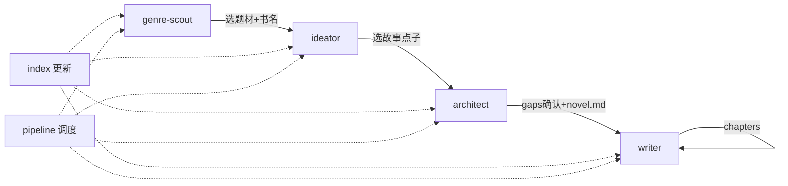

# 全流程审查 · Pipeline Review

> 审查日期：2026-09-17。四 Agent + 索引 + 调度。

## 闭环总览



## Agent 能力矩阵

| Agent | 输入 | 输出 | STOP 点 | 状态 |
|-------|------|------|---------|------|
| fiction-genre-scout | 无/偏好 | `_genres/*.md` | 选题材 | ✅ 闭环 |
| fiction-ideator | 题材+书名 | `_ideas/*.md` + `*-selected.md` | 选点子 | ✅ 闭环 |
| fiction-architect | 想法 | `fiction/书名/*` | gaps 确认 | ✅ 闭环 |
| fiction-writer | novel.md | `chapters/*.md` | 蓝图缺失时 STOP | ✅ 闭环 |
| fiction-index | — | INDEX.md 检索 | — | ✅ 新增 |
| fiction-pipeline | index | 路由建议 | — | ✅ 新增 |

## 审查结论：**可全流程跑通**

从「不知道写什么」到「连载正文」链路完整，无需再增写作类 Agent。

## 已补衔接（本次）

| 缺口 | 处理 |
|------|------|
| 各 Agent 产出后无统一检索 | 新增 `update-index.ps1` + `INDEX.md` + `fiction-index` |
| 用户不知下一步 | 新增 `fiction-pipeline` 调度 Skill |
| ideator→architect 靠手动粘贴 | ideator 选定后写 `fiction/_ideas/{书名}-selected.md` 交接 |
| 各 Agent 写完后索引过期 | 各 Skill 末尾增加「运行 update-index」 |
| 文件夹名与锁定书名不一致 | architect 用书名（去书名号）作目录名 |

## 不必新增的 Agent

| 曾考虑 | 原因不建 |
|--------|----------|
| 扩章专员 | writer 模式 E 已覆盖 |
| 修订专员 | writer 模式 F 已覆盖 |
| 撞名专员 | 已内置在 genre-scout |
| 出版/排版 | 超出当前 scope |

## 可选入口（跳过前面步骤）

| 用户已有 | 从哪开始 |
|----------|----------|
| 完整想法 | architect |
| 仅题材 | ideator |
| 仅架构+novel | writer |

## 文件交接规范

```
fiction/_genres/{date}-scout.md     status: selected
fiction/_ideas/{书名}-selected.md   ← ideator 选定后
fiction/{书名}/idea.md
fiction/{书名}/gaps.md              status: confirmed
fiction/{书名}/architecture.md
fiction/{书名}/novel.md             status: outlining → writing
fiction/{书名}/chapters/NNN.md
```

## 维护

内容变更后运行：

```powershell
.\scripts\update-index.ps1
```
